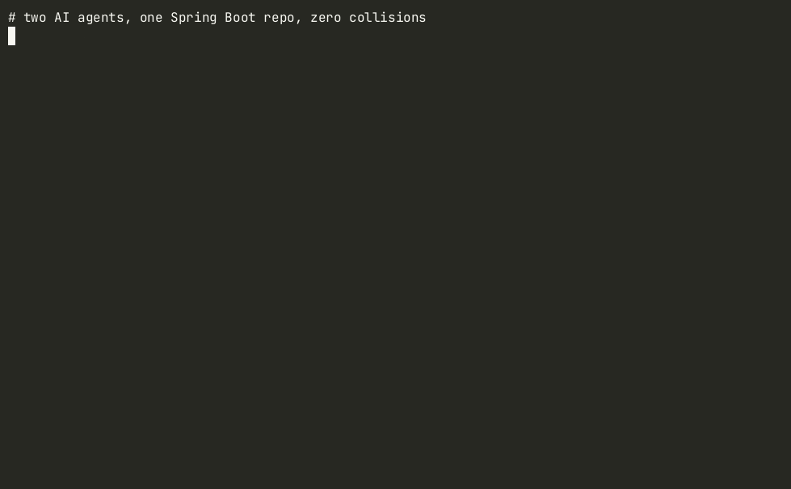

# wt-java

**Run several AI coding agents in parallel on one Spring Boot repo — without port, database or Redis collisions.**

[](https://github.com/agentreadystack/wt-java/actions/workflows/ci.yml)
[](LICENSE)

Claude Code, Codex and friends work best when each one has its own `git worktree`. But every Spring Boot
worktree wants port 8080, the same Postgres schema and the same Redis db, so two agents running tests at once
step on each other. `wt-java` gives every worktree its own **slot**: a backend port, a Vite port,
a Postgres schema and a Redis logical db, and wires them into Spring Boot automatically.



It's a single Bash script with no dependencies beyond `git` (plus `psql` / `redis-cli` if you want the DB/Redis steps).

## Quickstart

```bash
curl -fsSL https://raw.githubusercontent.com/agentreadystack/wt-java/main/install.sh | sh

cd ~/code/my-spring-app
wt-java new claude-login          # ../my-spring-app-claude-login on branch wt/claude-login
wt-java new codex-billing         # ../my-spring-app-codex-billing on branch wt/codex-billing

cd ../my-spring-app-claude-login && claude      # agent 1: port 8101, schema wt_claude_login, redis db 1
cd ../my-spring-app-codex-billing && codex      # agent 2: port 8102, schema wt_codex_billing, redis db 2

wt-java ls
wt-java rm claude-login --drop-db --delete-branch   # merged? clean up everything
```

Inside a worktree, `./mvnw spring-boot:run` just works: it starts on the slot's port, against the slot's
schema and Redis db, with no flags.

## What `wt-java new` does

1. `git worktree add ../<repo>-<name> -b wt/<name>` (from `HEAD` or a base ref you pass).
2. Allocates the lowest free slot `N` (1–15): `SERVER_PORT=8100+N`, `VITE_PORT=5200+N`, `REDIS_DB=N`, `DB_SCHEMA=wt_<name>`.
3. Creates the Postgres schema (`CREATE SCHEMA IF NOT EXISTS`). If `psql` is missing or Postgres is down you get a warning, not a failure.
4. Writes `.env.worktree` (for `source`, docker compose, Vite, scripts):
   ```
   WT_NAME=claude-login
   SERVER_PORT=8101
   VITE_PORT=5201
   SPRING_PROFILES_ACTIVE=local,wt
   DB_SCHEMA=wt_claude_login
   SPRING_FLYWAY_SCHEMAS=wt_claude_login
   SPRING_DATASOURCE_HIKARI_SCHEMA=wt_claude_login
   REDIS_DB=1
   SPRING_DATA_REDIS_DATABASE=1
   ```
5. Writes `config/application.yml` and `config/application-wt.yml` (`server.port`, Hikari/Flyway/Hibernate schema,
   `spring.data.redis.database`). Spring Boot loads `./config/*.yml` from the working directory on its own, so
   nothing in your repo has to change. If you already track a `config/application.yml`, wt-java leaves it alone
   and you run with `SPRING_PROFILES_ACTIVE=wt` instead.
6. Copies untracked local files you list (default: `.env`) and optionally runs `npm ci` for the frontend.

Generated files go into the worktree's `info/exclude`, so they never show up in `git status` and your `.gitignore` stays untouched.

## Commands

| Command | |
|---|---|
| `wt-java new <name> [base-ref]` | create worktree + slot |
| `wt-java rm <name> [--drop-db] [--keep-redis] [--delete-branch] [--force]` | remove worktree, `FLUSHDB` its Redis db (only that db), free the slot. Refuses to remove uncommitted work unless you pass `--force` |
| `wt-java ls` | list worktrees with port / Vite port / Redis db / schema; flags entries whose directory is gone |
| `wt-java env <name>` | print a worktree's `.env.worktree` |
| `wt-java gc` | drop registry entries whose directory no longer exists (and `git worktree prune`) |

## Configuration

Put a `.wt-java.conf` (`KEY=VALUE`, `#` comments) in the main repo root, or set the same keys as environment
variables. Environment variables win. Unknown keys are ignored with a warning, and the file is parsed, never executed.

| Key | Default | |
|---|---|---|
| `WT_JAVA_BASE_PORT` | `8100` | backend port = base + slot |
| `WT_JAVA_VITE_BASE_PORT` | `5200` | Vite port = base + slot |
| `WT_JAVA_MAX_REDIS_DB` | `15` | max slots (Redis has dbs 0–15 by default; slot 0 is left for your main checkout) |
| `WT_JAVA_DB` | `auto` | `auto` (use `psql` if installed), `postgres`, or `none` |
| `PGHOST` `PGPORT` `PGUSER` `PGPASSWORD` `PGDATABASE` | libpq defaults | Postgres connection used for schema create/drop |
| `WT_JAVA_REDIS` | `auto` | `auto` (use `redis-cli` if installed), `on`, or `none` |
| `REDIS_HOST` `REDIS_PORT` `REDIS_PASSWORD` | `127.0.0.1` `6379` | Redis used for `FLUSHDB` on `rm` |
| `WT_JAVA_SPRING_DIR` | `.` | directory you run `spring-boot:run` from, e.g. `backend` in a monorepo |
| `WT_JAVA_SPRING_CONFIG` | `on` | `off` = only write `.env.worktree` |
| `WT_JAVA_COPY` | `.env` | space-separated untracked files/dirs to copy into new worktrees |
| `WT_JAVA_NPM_CI` | *(empty)* | frontend dir to run `npm ci` in, e.g. `frontend` |

Example for a `backend/` + `frontend/` monorepo:

```ini
# .wt-java.conf
PGHOST=localhost
PGUSER=app
PGDATABASE=app
WT_JAVA_SPRING_DIR=backend
WT_JAVA_COPY=.env backend/.env frontend/.env.local
WT_JAVA_NPM_CI=frontend
```

Don't commit real passwords in `.wt-java.conf`. Use `PGPASSWORD` from your shell or `~/.pgpass`.

**Build caches:** worktrees share `~/.m2` and `~/.gradle` by default, and `npm ci` uses the shared `~/.npm`
cache with `--prefer-offline`, so a new worktree doesn't download the internet again. wt-java never points
these at per-worktree directories.

**Frontend:** in `vite.config.ts`, use `server: { port: Number(process.env.VITE_PORT) || 5173 }` and start with
`set -a; . ./.env.worktree; npm run dev`.

## Install

```bash
curl -fsSL https://raw.githubusercontent.com/agentreadystack/wt-java/main/install.sh | sh   # -> ~/.local/bin
# or pick a location / version:
curl -fsSL https://raw.githubusercontent.com/agentreadystack/wt-java/main/install.sh | WT_JAVA_PREFIX=/usr/local/bin WT_JAVA_REF=v0.2.0 sh
# or from a clone:
git clone https://github.com/agentreadystack/wt-java && ln -s "$PWD/wt-java/bin/wt-java" ~/.local/bin/wt-java
```

Requires Bash 3.2+ and git 2.31+. Works on Linux, macOS and WSL.

## Tests

```bash
./test/test.sh
# with Postgres + Redis integration tests:
docker run -d --rm -p 5432:5432 -e POSTGRES_PASSWORD=pw postgres:16-alpine
docker run -d --rm -p 6379:6379 redis:7-alpine
WT_JAVA_TEST_PG=1 PGHOST=127.0.0.1 PGUSER=postgres PGPASSWORD=pw WT_JAVA_TEST_REDIS=1 ./test/test.sh
```

CI runs `shellcheck` and the full suite against real Postgres and Redis on Linux, plus the core suite on macOS.

## Roadmap

Gradle-specific helpers, MySQL databases, and a Homebrew formula ([#6](https://github.com/agentreadystack/wt-java/issues/6)).
Ideas and PRs are welcome, see [CONTRIBUTING.md](CONTRIBUTING.md).

## Need the full SaaS stack?

wt-java comes out of **[AgentReady Stack](https://agentreadystack.com)**, a Spring Boot + Vue SaaS starter built
to be worked on by AI agents: JWT auth, multi-tenancy, billing and webhooks, an admin panel, and tuned
`CLAUDE.md` / `AGENTS.md`, subagents and skills for Claude Code and Codex.
If you'd rather start from a working product than a blank repo → **https://agentreadystack.com**

## License

[MIT](LICENSE)
